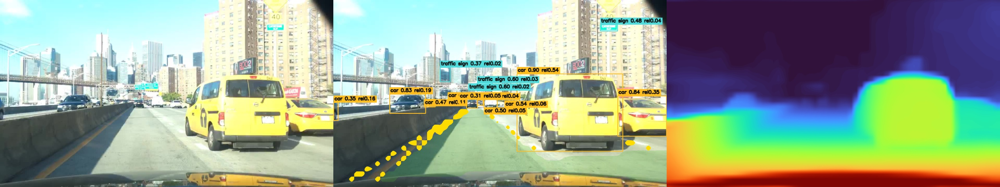
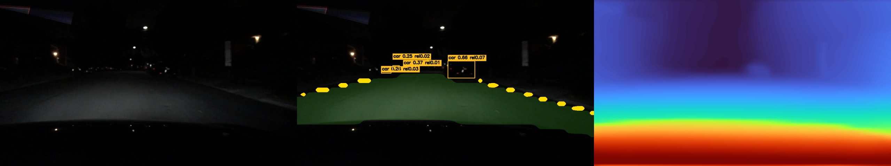
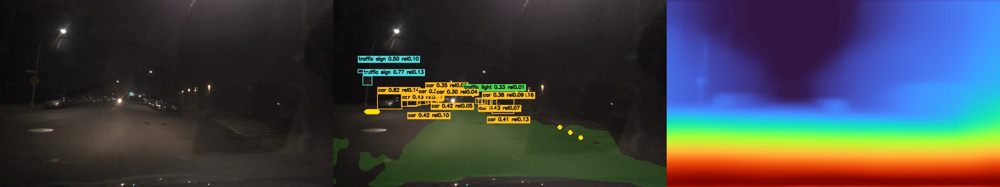
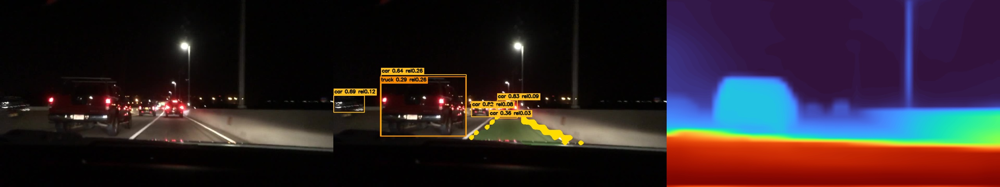
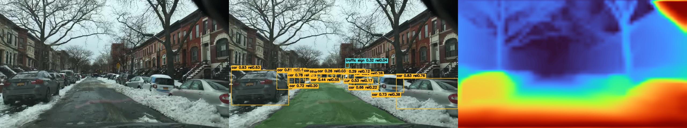

# RoadScope-N5

RoadScope-N5 is a compact, standalone multi-task model for static road-scene
perception. One ONNX graph performs object detection, drivable-road
segmentation, lane-marking segmentation, relative-depth estimation, and scene
quality estimation in a single inference pass.

The released artifact is not an ensemble. Inference loads only
`roadscope_n5.onnx`; no additional perception model is required at runtime.

## Highlights

- One 12.1 MiB ONNX model with approximately 3.11 million stored parameters.
- Published SHA-256 checksum in [`CHECKSUMS.sha256`](CHECKSUMS.sha256).
- Five synchronized outputs from one shared network.
- Arbitrary source-image resolution through aspect-ratio-preserving letterbox
  preprocessing.
- CPU inference through ONNX Runtime, with optional CUDA execution.
- Command-line, Windows launcher, and reusable Python API.
- Public architecture, training, evaluation, export, FP16, INT8, benchmark,
  and validation source.
- Strict checks for model contracts, invalid thresholds, NaN/Inf outputs,
  duplicate filenames, and failed image writes.

## Demo Gallery

Each result contains the original image, the combined perception overlay, and
the relative-depth visualization.

| Scene | Result |
|---|---|
| Strong daylight glare |  |
| Degraded night visibility |  |
| Low-contrast night street |  |
| Night highway traffic |  |
| Snow-covered street |  |

These are qualitative examples, not ground-truth annotations or proof of
safety. The scenes originate from BDD100K and remain subject to their
applicable data terms; see [Data and Demo Image Notice](DATA_NOTICE.md).

## Quick Start

### 1. Install the runtime

Python 3.10 or newer is required.

```bash
python -m pip install -r requirements.txt
```

### 2. Add images

Place JPG, JPEG, PNG, BMP, or WebP files in `input/`.

### 3. Run

On Windows, double-click `RUN.bat`.

On any supported platform:

```bash
python run.py --source input --output output
```

The output directory receives annotated images, relative-depth maps,
side-by-side comparisons, and JSON reports.

## Install as a Python Project

An editable install exposes the `roadscope-n5` command and Python package:

```bash
python -m pip install -e .
roadscope-n5 --source input --output output
```

For training, evaluation, export, and deployment conversion tools:

```bash
python -m pip install -e ".[train]"
```

For tests and development checks:

```bash
python -m pip install -e ".[train,dev]"
python -m unittest discover -s tests -v
```

## Python API

```python
import cv2

from roadscope_n5.inference import RoadScopeRuntime

runtime = RoadScopeRuntime("roadscope_n5.onnx", provider="cpu")
image = cv2.imread("input/example.jpg")
prediction = runtime.predict(image)

print(prediction.boxes.shape)
print(prediction.quality)
print(prediction.inference_ms)
```

All dense maps returned by `predict` are restored to the source image
resolution. See [Python API](docs/API.md) for the complete contract.

## Outputs

| Output | Meaning |
|---|---|
| `detections` | Bounding boxes and scores for ten road-scene classes |
| `road` | Drivable-road probability map |
| `lane` | Lane-marking probability map |
| `relative_depth` | Image-relative near/far structure |
| `confidence` | Bounded scene-quality signal |

The detection classes are pedestrian, rider, car, truck, bus, train,
motorcycle, bicycle, traffic light, and traffic sign.

Relative depth is not physical distance. Scene quality is not a probability of
safety or correctness.

## Generated Files

For an input named `scene.jpg`, the CLI creates:

| File | Contents |
|---|---|
| `scene_annotated.jpg` | Boxes, class confidence, relative cue, road, and lane overlay |
| `scene_relative_depth.png` | Colorized relative-depth map |
| `scene_comparison.jpg` | Original, overlay, and depth panels |
| `scene.json` | Machine-readable predictions and runtime information |

Private input images and newly generated output files are ignored by Git by
default. Only the packaged examples are tracked.

## Source Layout

```text
RoadScope-N5/
|-- roadscope_n5.onnx
|-- run.py
|-- RUN.bat
|-- pyproject.toml
|-- requirements.txt
|-- requirements-train.txt
|-- src/roadscope_n5/
|   |-- contracts.py
|   |-- inference.py
|   |-- training/
|   |   |-- model.py
|   |   |-- dataset.py
|   |   |-- losses.py
|   |   |-- train.py
|   |   |-- evaluate.py
|   |   `-- export.py
|   `-- tools/
|       |-- benchmark_onnx.py
|       |-- benchmark_runtime.py
|       |-- build_target.py
|       |-- convert_fp16.py
|       |-- quantize_onnx.py
|       |-- validate_int8.py
|       `-- validate_onnx.py
|-- tests/
|-- docs/
|-- input/
`-- output/
```

## Training and Evaluation

The public training pipeline consumes:

1. road-scene images;
2. YOLO-format detection labels;
3. aligned dense targets for road, lane, relative depth, validity, and target
   quality.

It supports mixed precision, AdamW, OneCycleLR, gradient accumulation,
gradient clipping, resumable checkpoints, and DistributedDataParallel.

Start with [Training Guide](docs/TRAINING.md) and
[Dense Target Format](docs/TARGET_FORMAT.md). Evaluation reports detection
precision, recall, AP50, AP50:95, road/lane overlap, relative-depth agreement,
ordinal consistency, and quality calibration.

No benchmark number should be copied across datasets, splits, hardware, or
runtime configurations. Run the supplied evaluator and benchmark tools on the
intended setup.

## Deployment Tools

The repository includes:

- PyTorch checkpoint to ONNX export;
- ONNX/PyTorch numerical validation;
- mixed-precision FP16 conversion;
- static QDQ INT8 quantization with image calibration;
- reduced-precision agreement validation;
- PyTorch and ONNX latency benchmarks.

See [Deployment Guide](docs/DEPLOYMENT.md).

## Documentation

- [Model Card](MODEL_CARD.md)
- [Architecture](docs/ARCHITECTURE.md)
- [Python API](docs/API.md)
- [Training Guide](docs/TRAINING.md)
- [Dense Target Format](docs/TARGET_FORMAT.md)
- [Deployment Guide](docs/DEPLOYMENT.md)
- [Contributing](CONTRIBUTING.md)
- [Security](SECURITY.md)
- [Third-Party Notices](THIRD_PARTY_NOTICES.md)
- [Data and Demo Image Notice](DATA_NOTICE.md)

## Safety Boundary

RoadScope-N5 is a research implementation for static-image perception. It does
not provide tracking, motion prediction, temporal stabilization, metric
ranging, trajectory planning, vehicle control, or certified safety behavior.

Do not use its output alone for steering, braking, acceleration, or any other
safety-critical action. A road mask does not prove that a path is obstacle
free, and a high quality value does not guarantee a correct prediction.

## License

This project, including the released model artifact, is distributed under the
GNU Affero General Public License v3.0. See [LICENSE](LICENSE) and
[Third-Party Notices](THIRD_PARTY_NOTICES.md).

If the AGPL-3.0 source-disclosure obligations do not fit a proprietary or
commercial deployment, review the applicable upstream commercial licensing
requirements before use.
