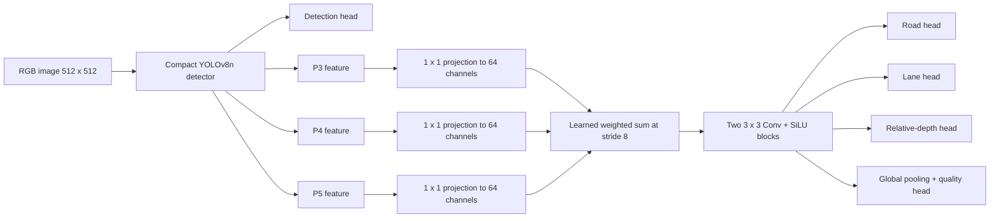

# Architecture

## Design Goal

RoadScope-N5 reduces five road-scene perception outputs to one compact deployment
graph. Detection and dense tasks share the same image encoder, so the deployed
system loads one model and performs one forward pass per image.

## Network Flow



The source implementation is in
[`src/roadscope_n5/training/model.py`](../src/roadscope_n5/training/model.py).

## Shared Features

The detection model exposes three feature maps immediately before the
detection head. Each map is projected to 64 channels with a `1 x 1`
convolution. Lower-resolution maps are bilinearly resized to the P3 spatial
resolution.

Three trainable logits are converted to fusion weights with softmax:

```text
w_i = exp(a_i) / sum_j exp(a_j)
F = w_3 P3 + w_4 P4 + w_5 P5
```

The weights are positive and sum to one. This keeps the fusion interpretable
and prevents unconstrained scale growth between feature levels.

## Dense Fusion and Heads

The fused tensor passes through two `3 x 3` convolutions with SiLU
activations. Four lightweight heads consume that shared representation:

| Head | Structure | Training output | ONNX output |
|---|---|---|---|
| Road | `1 x 1` convolution | logits | sigmoid probability |
| Lane | `1 x 1` convolution | logits | sigmoid probability |
| Relative depth | `1 x 1` convolution + sigmoid | `[0, 1]` map | `[0, 1]` map |
| Scene quality | global average pooling + linear | logit | sigmoid scalar |

At an input size of `512 x 512`, dense heads operate at `64 x 64`. The public
inference code restores each map to source-image resolution after removing
letterbox padding.

## Detection Head

The detector predicts center-format boxes and class scores for ten classes.
The exported tensor is decoded by the public runtime using confidence
filtering and class-aware non-maximum suppression.

## Training Objectives

### Detection

The detector's native localization, classification, and distribution losses
are combined through its public training interface.

### Road and Lane

Each segmentation task combines masked binary cross entropy and Dice loss.
Lane terms receive a factor of `1.5` because positive lane pixels are sparse.
Invalid padded pixels are excluded.

### Relative Depth

The relative-depth objective contains:

- masked Smooth L1 value agreement;
- horizontal and vertical gradient agreement, weighted by `0.25`;
- ordinal pair agreement, weighted by `0.10`.

Only pixels marked by `depth_valid` contribute.

### Scene Quality

The quality head uses binary cross entropy against a bounded target in
`[0, 1]`.

### Multi-Task Balance

Four learned log-variance parameters balance detection, segmentation, depth,
and quality losses:

```text
L_total = sum_i exp(-s_i) L_i + s_i
```

Each `s_i` is clamped to `[-5, 5]`. This prevents one task from dominating the
shared feature extractor while retaining learned task weighting.

## Export Contract

The released ONNX model uses opset 17.

| Name | Type | Shape description |
|---|---|---|
| `images` | float32 | `N x 3 x 512 x 512` |
| `detections` | float32 | `N x 14 x 5376` for the released input size |
| `road` | float32 | `N x 1 x 64 x 64` |
| `lane` | float32 | `N x 1 x 64 x 64` |
| `relative_depth` | float32 | `N x 1 x 64 x 64` |
| `confidence` | float32 | `N` |

Batch is dynamic. Spatial input dimensions are fixed in the released artifact.

## Deployment Independence

The ONNX graph contains the detector, feature fusion, and all auxiliary heads.
There is no model-to-model call, runtime cascade, or external feature service.
All post-processing in `src/roadscope_n5/inference.py` operates on the five outputs
of this single graph.
